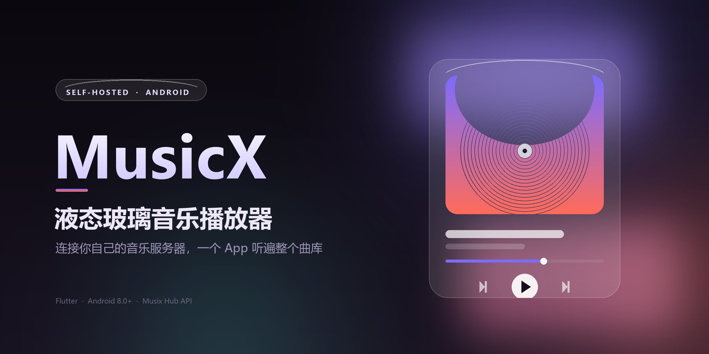

# MusicX · APK Releases

**A liquid-glass Android music player — this repo ships the installers only; source lives in [musixandroid](https://github.com/singleton-altman/musixandroid).**

[**Download latest APK**](https://github.com/xijin285/MusicXApp/releases/latest)　·　[All versions](https://github.com/xijin285/MusicXApp/releases)　·　[Source repo](https://github.com/singleton-altman/musixandroid)　·　English / [中文](README.zh-CN.md)

---

## What is this

The **official APK release repository for MusicX**: every formal build from the source repo is published here automatically, and the app's in-app updater uses these Releases as its source of truth.

| | |
| --- | --- |
| Latest version | See [Releases / latest](https://github.com/xijin285/MusicXApp/releases/latest) |
| Requirements | Android 8.0+ (minSdk 26) |
| Package | One `app-release.apk` per release, signed with the official release key |
| Naming | `MusicX major(build)` e.g. `MusicX 0.8.12(010)` |

## Quick start

|  | What to do | Details |
| :-: | --- | --- |
| **1** | Start your music server | Needs a Musix Hub compatible REST API running on your own device |
| **2** | Download and install the APK | Grab the latest from [Releases](https://github.com/xijin285/MusicXApp/releases/latest) |
| **3** | Enter address and password | Open the app, type the server address, and the library starts syncing once you sign in |

> The first sign-in only needs an **address + password**. Connection details are used solely to reach your own library and are never uploaded to any third party.

## In-app updates

"Check for updates" in the app reads these Releases directly:

- Automatic mirror speed-testing, background download and resume
- One-tap upgrade in the app whenever a new version is published

## Version history

All historical installers: [Releases](https://github.com/xijin285/MusicXApp/releases).

---

Source & docs: [**singleton-altman/musixandroid**](https://github.com/singleton-altman/musixandroid)

