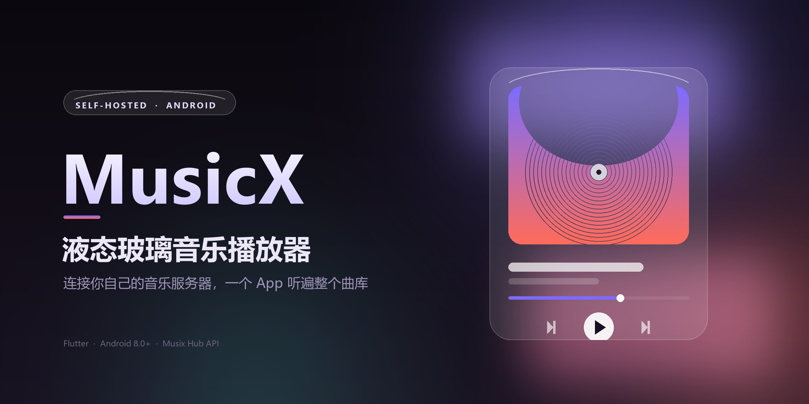

# MusicX · 安装包发布仓库

**液态玻璃风格的 Android 音乐播放器 —— 这里只放安装包，源码在 [musixandroid](https://github.com/singleton-altman/musixandroid)。**

[**下载最新 APK**](https://github.com/xijin285/MusicXApp/releases/latest)　·　[全部版本](https://github.com/xijin285/MusicXApp/releases)　·　[源码仓库](https://github.com/singleton-altman/musixandroid)　·　中文 / [English](README.md)

---

## 这是什么

MusicX 的 **Android 安装包发布仓库**：源码仓库每次构建出的正式 APK 都会自动发布到这里，App 内的「检查更新」也以这里的 Releases 为准。

| | |
| --- | --- |
| 最新版本 | 见 [Releases / latest](https://github.com/xijin285/MusicXApp/releases/latest) |
| 系统要求 | Android 8.0+（minSdk 26） |
| 安装包 | 每个版本一个 `app-release.apk`，带正式发布签名 |
| 版本命名 | `MusicX 主版本(构建号)`，如 `MusicX 0.8.12(010)` |

## 三步开始

|  | 做什么 | 说明 |
| :-: | --- | --- |
| **1** | 启动音乐服务器 | 需要 Musix Hub 兼容的 REST API，跑在你自己的设备上 |
| **2** | 下载并安装 APK | 从 [Releases](https://github.com/xijin285/MusicXApp/releases/latest) 取最新版 |
| **3** | 填入地址与密码 | 打开 App 输入服务器地址，登录后即开始同步曲库 |

> 首次登录只需**地址 + 密码**，连接信息仅用于访问你的个人音乐库，不上传任何第三方。

## 应用内更新

App 内「设置 → 检查更新」会直接读取本仓库的 Releases：

- 自动测速选择可用下载线路，支持后台下载与断点续传
- 新版本发布后无需重新下载安装包，App 内一键升级

## 版本历史

全部历史安装包见 [Releases 页面](https://github.com/xijin285/MusicXApp/releases)。

---

源码与文档：[**singleton-altman/musixandroid**](https://github.com/singleton-altman/musixandroid)（[中文文档](https://github.com/singleton-altman/musixandroid/blob/main/README.zh-CN.md)）

